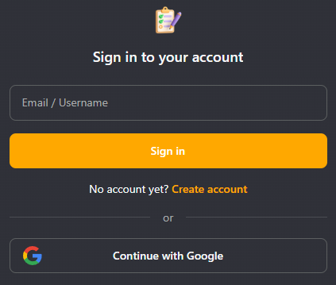
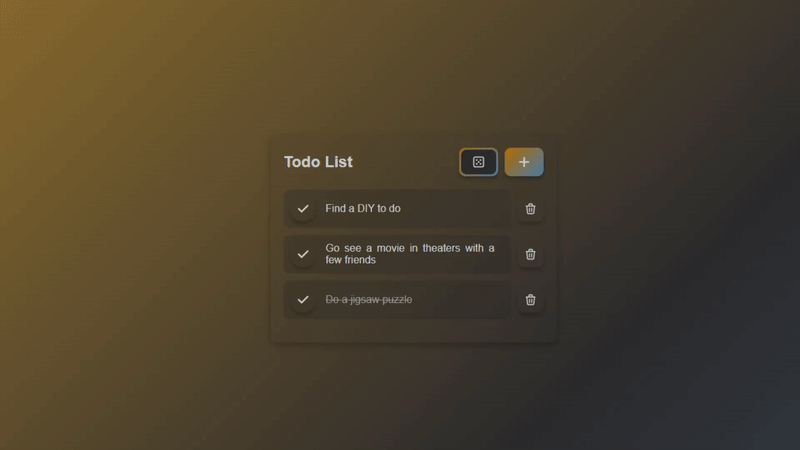

# Procrasti-Not

<div align="center">
    
    <br>
    
    
    
    
    
    <br>
    <br>
</div>

Procrasti Not is a simple todo list application built with SvelteKit. It stores data in a MongoDB cluster and includes user authentication, todo management, AI-powered text correction, and theme customization.

## ✨ Features

- User authentication via [Logto.io](https://docs.logto.io/introduction), with Google sign-in support.
- Add, complete, and delete todos.
- Add random todos using the [DummyJson](https://dummyjson.com/docs/todos) API.
- Correct typos in custom todos with the [Gemini](https://ai.google.dev/gemini-api/docs) API.
- Switch between themes: _Light_, _Alpine_, _Dark_, and _Cyberpunk_.

## 🖼️ Screenshots & Demo

### Login

Log in using Logto.io or Google authentication.

<div align="center">
    
</div>

### Theme Switching

Switch between included themes.
<div align="center">
    
</div>

### Managing Todos

Add random todos, mark tasks as completed, or delete them.

<div align="center">
    
</div>

### Custom Todo with AI Correction

Add custom todos and use AI to correct typos.

<div align="center">
    
</div>

## 🛠️ Development

```bash
npm install
cp .env.example .env   # fill in the values
npm run dev
npm run check          # type check
npm test               # unit tests
```

See [`.env.example`](./.env.example) for every required variable (MongoDB, Logto, Gemini).

### API

All endpoints require a signed-in user and only ever touch that user's data. Bodies are JSON (`Content-Type: application/json`) and errors use proper HTTP status codes.

| Method | Route | Purpose |
| --- | --- | --- |
| `POST` | `/api/todos` | Create a todo `{ text }` |
| `PATCH` | `/api/todos/:id` | Edit `{ text }` and/or complete `{ isDone }` |
| `DELETE` | `/api/todos/:id` | Soft-delete a todo |
| `PUT` | `/api/users/theme` | Save the theme `{ theme }` |
| `POST` | `/api/gemini` | Fix typos `{ text }` (10 requests/minute per user) |

---

<div align="right">
    <a href="https://github.com/imAlessas"> <samp> @imAlessas </samp> </a>
</div>
